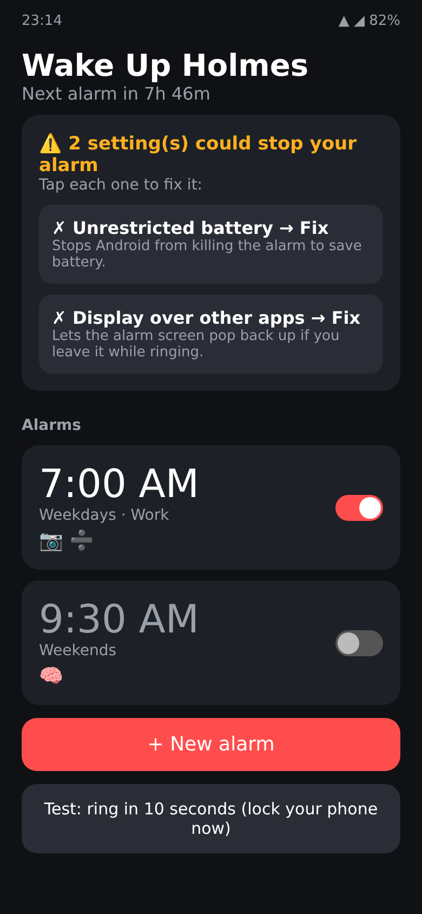
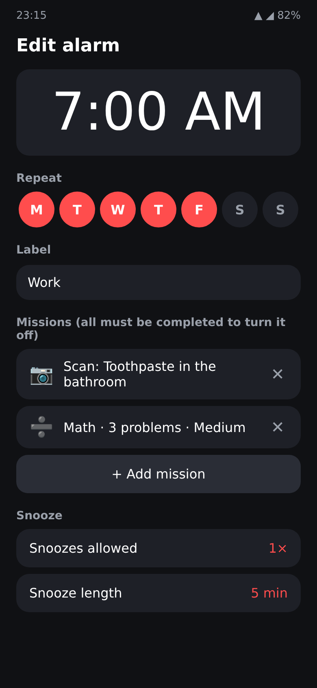
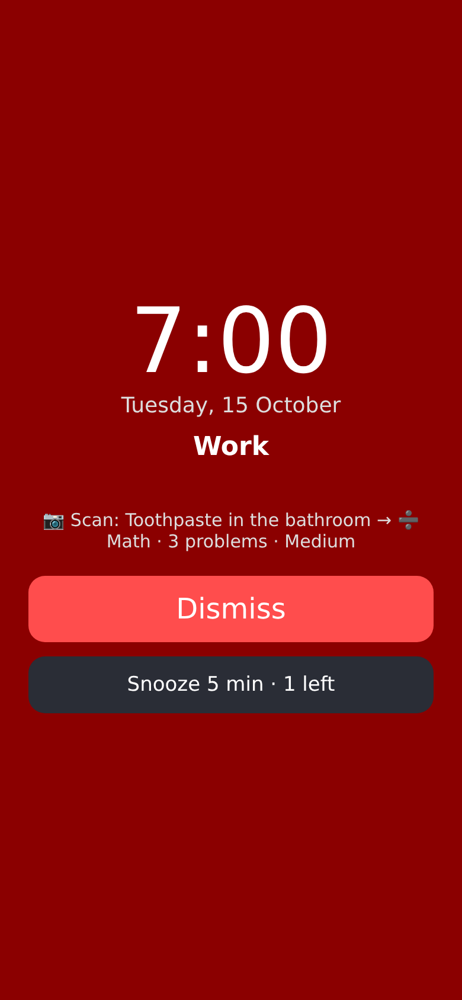
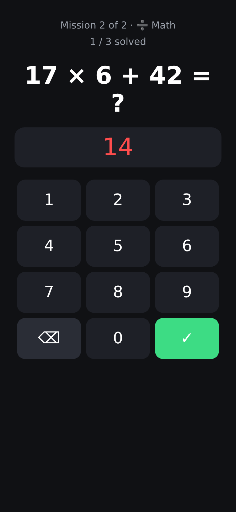
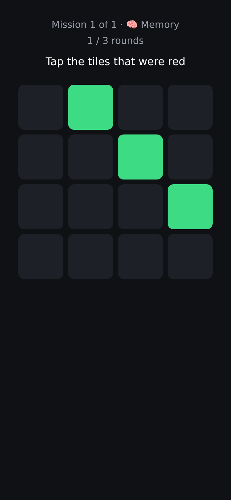
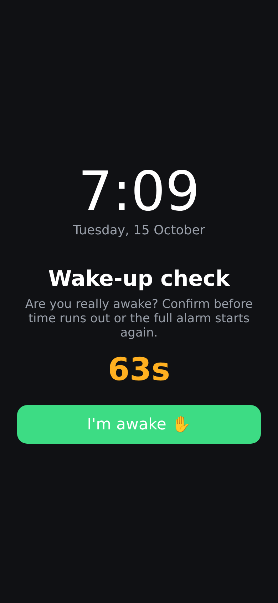

# Wake Up Holmes

An Android alarm for heavy sleepers, modelled on Alarmy ("Sleep If U Can").
The only way to turn it off is to complete the alarm's missions.

## Features

- **Missions** (up to 5 per alarm, done in order):
  - ➗ **Math**: 5 difficulty levels
  - 🧠 **Memory**: remember a tile pattern
  - ⌨️ **Typing**: type phrases exactly
  - 📳 **Shake**: shake the phone N times
  - 🚶 **Steps**: walk N steps
  - 📷 **Barcode / QR**: scan something you registered in another room. If you can't find it, a hard-math fallback unlocks after 5 minutes.
- **Quiet while you work.** The sound drops while you're doing a mission and returns at full volume if you stop for 12 seconds.
- **Wake-up check.** A few minutes after you dismiss the alarm, you have to confirm you're awake. If you don't, the full alarm starts again.
- **Limited snoozes** for each alarm (0–5).
- **Hard to silence.** Alarm volume is forced to max every second. Volume and back buttons are ignored, and the alarm screen reopens if you leave it.
- **Loud.** A built-in harsh siren by default. If you choose a gentler ringtone, the siren is added after 45 seconds. Also vibration, a flashlight strobe and a flashing max-brightness screen.
- **Reliable.** Alarms are scheduled with `setAlarmClock` (exempt from Doze). They survive reboots (even before you unlock the phone), time and timezone changes, and app updates. While the alarm rings, a watchdog alarm brings it back if Android kills the app.
- **Setup checklist** in the app finds every phone setting that could block an alarm, and **Test** rings 10 seconds later so you can check it on the lock screen.

## Install

Every push builds the app with GitHub Actions. Download `WakeUpHolmes.apk` from the
[**latest release**](../../releases/tag/latest) on your phone and open it. You may need to allow
"Install unknown apps" for your browser. Then open the app and fix everything in the checklist.

## Build locally

```
./gradlew assembleRelease   # needs the Android SDK
```

## Screens (mockups)

These are drawn from the app's layout code, not captured from a phone.

| Home | Edit alarm | Ringing |
|---|---|---|
|  |  |  |
| **Math mission** | **Memory mission** | **Wake-up check** |
|  |  |  |
