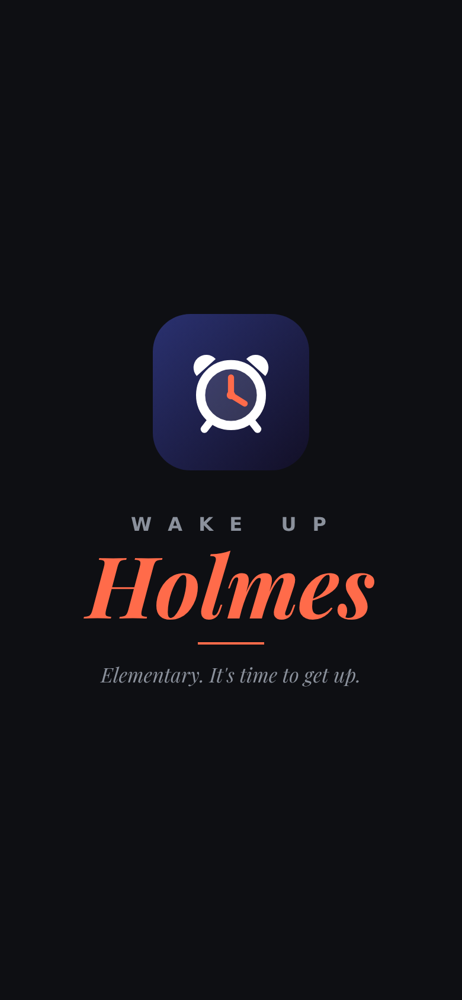
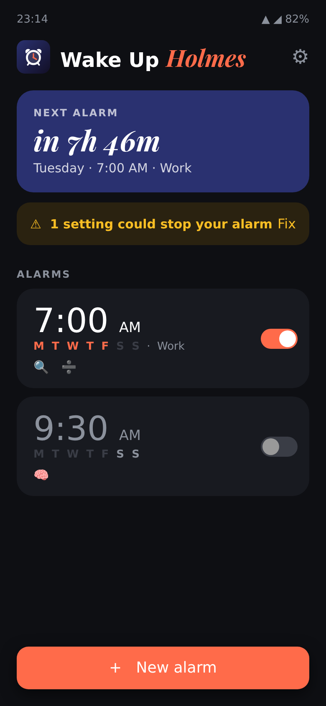
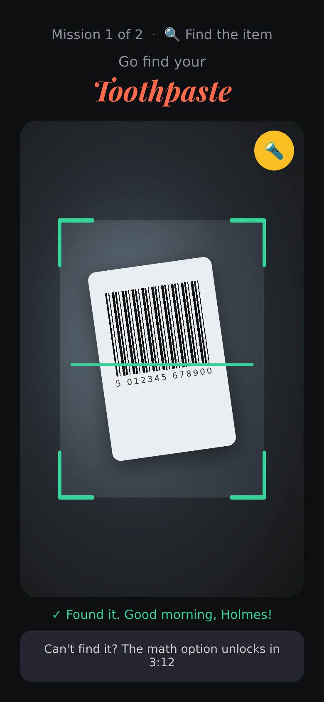
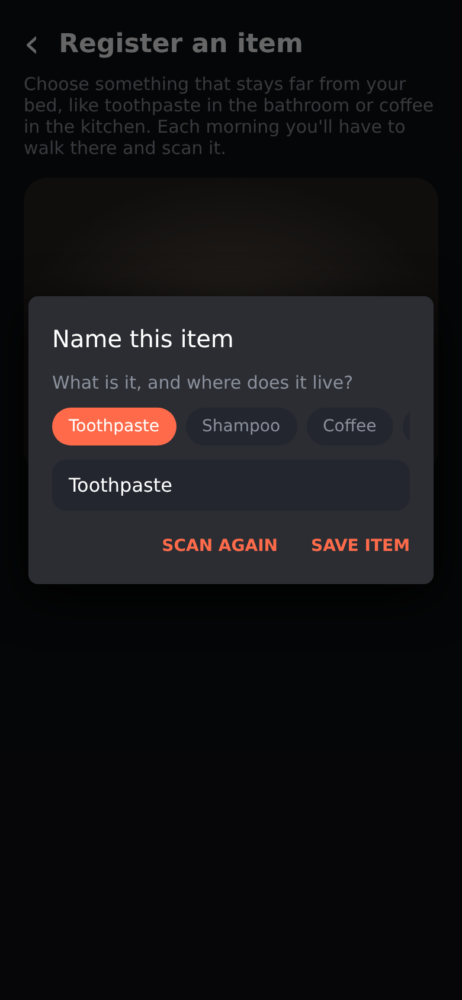
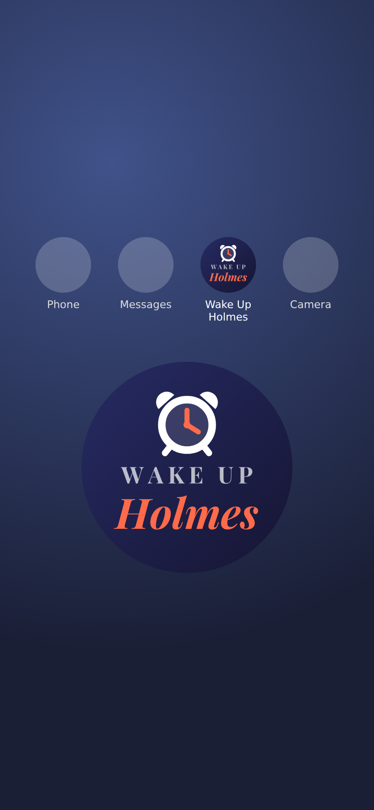

# Wake Up Holmes

An Android alarm for heavy sleepers, modelled on Alarmy ("Sleep If U Can"). The logo and wordmark use Playfair Display (SIL Open Font License, see `licenses/`).
The only way to turn it off is to complete the alarm's missions.

## Features

- **Missions** (up to 5 per alarm, done in order):
  - ➗ **Math**: 5 difficulty levels
  - 🧠 **Memory**: remember a tile pattern
  - ⌨️ **Typing**: type phrases exactly
  - 📳 **Shake**: shake the phone N times
  - 🚶 **Steps**: walk N steps
  - 🔍 **Find the item**: walk to an item you registered in another room (like your toothpaste) and scan its barcode. Uses Google ML Kit + CameraX, so it reads codes at any angle, small or curved, and in dim light (with a flashlight button). It gives green/red feedback and 90 seconds of quiet to walk there. If you really can't find the item, a hard-math option unlocks after 5 minutes.
- **Quiet while you work.** The sound drops while you're doing a mission and returns at full volume if you stop for 12 seconds.
- **Wake-up check.** A few minutes after you dismiss the alarm, you have to confirm you're awake. If you don't, the full alarm starts again.
- **Uninstall protection** (optional, in Settings). The app becomes a device admin, so Android won't uninstall it.
  Switching that off in Android's settings locks the phone and sets off the full alarm until you finish your missions.
  The clean way out is in the app: solve 10 very hard math problems and type 3 phrases, then uninstall normally.
- **Limited snoozes** for each alarm (0–5).
- **Hard to silence.** Alarm volume is forced to max every second. Volume and back buttons are ignored, and the alarm screen reopens if you leave it.
- **Loud.** A built-in harsh siren by default. If you choose a gentler ringtone, the siren is added after 45 seconds. Also vibration, a flashlight strobe and a flashing max-brightness screen.
- **Reliable.** Alarms are scheduled with `setAlarmClock` (exempt from Doze). They survive reboots (even before you unlock the phone), time and timezone changes, and app updates. While the alarm rings, a watchdog alarm brings it back if Android kills the app.
- **Setup checklist** in the app finds every phone setting that could block an alarm, and **Test** rings 10 seconds later so you can check it on the lock screen.

## Install (phone)

Every push builds the app with GitHub Actions. Download `WakeUpHolmes.apk` from the
[**latest release**](../../releases/tag/latest) on your phone and open it. You may need to allow
"Install unknown apps" for your browser. Then open the app and fix everything in the checklist.

## Gemini / voice

- Say "Hey Google, set an alarm for 7 AM". Wake Up Holmes handles Android's standard *set alarm* request,
  so if Gemini or another app sends it here (or asks you to pick an app), the alarm is created with your first alarm's missions.
- Gemini usually puts alarms in Google Clock. Turn on **Settings › Gemini & voice › Follow Gemini / Google Clock alarms**
  and Wake Up Holmes adds a matching alarm for any Google Clock alarm due within the next 24 hours.

## Galaxy Watch (Wear OS) app

**Tile:** swipe through your watch tiles and add **Wake Up Holmes** to see your next alarm and countdown at a glance.

When the phone alarm rings, the watch strobes red and white, vibrates in full-strength bursts, and plays a 3 kHz
smoke-alarm siren through its speaker with its alarm volume pinned to max. You can turn the watch siren off in
Settings › Galaxy Watch. It shows a full-screen alarm and buzzes hard until you finish
the mission **on the phone**. There's no way to turn it off from the watch. It also stops by itself
if it loses contact with the phone for 90 seconds.

Samsung's Galaxy Wearable app can't install APK files, so you install `WakeUpHolmes-Watch.apk` once over Wi-Fi:

1. **On the watch:** Settings › About watch › Software › tap *Software version* 5 times to unlock Developer options.
   Then Settings › Developer options: turn on **ADB debugging** and **Wireless debugging**.
2. Make sure the watch and phone are on the **same Wi-Fi**.
3. **On the phone:** install a Wear OS sideloading app from the Play Store, such as **"Bugjaeger"** or **"Wear Installer 2"**.
   Download `WakeUpHolmes-Watch.apk` from the latest release.
4. In that app, enter the watch's IP address and port (shown under Wireless debugging on the watch), pair if asked,
   then install `WakeUpHolmes-Watch.apk`.
5. Open **Wake Up Holmes** on the watch once and allow notifications. It should say "✓ Connected".
   On the phone, go to ⚙ Settings › Galaxy Watch › **Test buzz on the watch**.

You can turn ADB/Wireless debugging off again afterwards. Updates install the same way.

## Build locally

```
./gradlew assembleRelease   # needs the Android SDK
```

## Screens (mockups)

These are drawn from the app's layout code, not captured from a phone.

| Startup | Home | Ringing |
|---|---|---|
|  |  |  |
| **Find the item** | **Register an item** | **App icon** |
|  |  |  |
